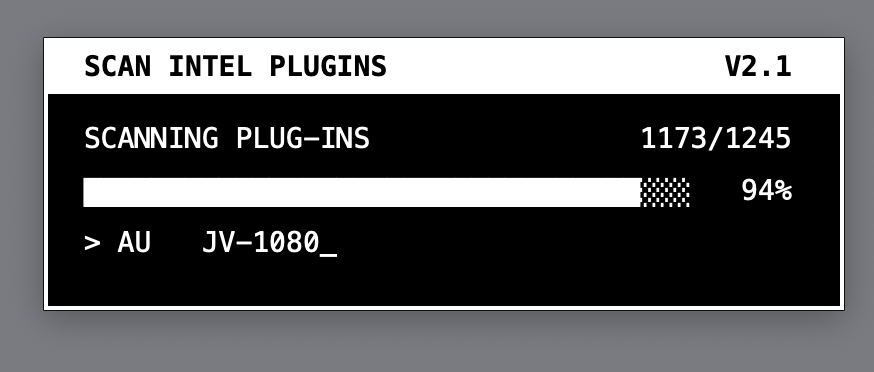

# Scan Intel Plugins V2 [Creme]

A small macOS app that scans your audio plug-ins and lists the ones that are a problem on Apple Silicon Macs (M1, M2, M3, M4…): plug-ins that still depend on Rosetta, and plug-ins that cannot load at all anymore.

Formerly **Scan Intel AU** (V1.1, Audio Units only).

[Download Scan Intel Plugins V2](https://github.com/Creme74/Scan-Intel-Plugins/raw/main/Scan%20Intel%20Plugins%20V2%20%5BCreme%5D.zip)

Then follow the [installation steps](#installation) below.

## What it finds

| Category | Meaning |
|---|---|
| **Need Rosetta** | Intel 64-bit only: no Apple Silicon code inside |
| **Cannot load at all** | 32-bit Intel or PowerPC: no current Mac or host can load them, Rosetta or not |
| **Could not be analysed** | Damaged or incomplete plug-ins, or aliases pointing to a missing file |

Native plug-ins (Apple Silicon or Universal) are counted but not listed: the report only shows what needs attention.

## Formats and folders

| Format | Folder |
|---|---|
| AU | `Library/Audio/Plug-Ins/Components` |
| VST | `Library/Audio/Plug-Ins/VST` |
| VST3 | `Library/Audio/Plug-Ins/VST3` |
| AAX | `Library/Application Support/Avid/Audio/Plug-Ins` |
| CLAP | `Library/Audio/Plug-Ins/CLAP` |

Each folder is scanned in both `/Library` (all users) and `~/Library` (your user), including vendor sub-folders.

## Installation

1. [**Download Scan Intel Plugins V2**](https://github.com/Creme74/Scan-Intel-Plugins/raw/main/Scan%20Intel%20Plugins%20V2%20%5BCreme%5D.zip) (the zip file goes to your Downloads folder).
2. Unzip it by **double-clicking** it in the Finder (don't use `unzip` in the Terminal: it drops part of the app's signature).
3. Move **Scan Intel Plugins.app** to your **Applications** folder.
4. First launch: macOS blocks the app because it is not notarized by Apple. Open **System Settings > Privacy & Security**, scroll down and click **Open Anyway**. You only need to do this once.

If macOS still refuses to open it, run this once in the Terminal:

```
xattr -dr com.apple.quarantine "/Applications/Scan Intel Plugins.app"
```

## Usage

1. Double-click the app. A small black & white window shows the progress of the scan: how many plug-ins have been checked, and which one is being analysed.

   

2. When the scan is done, a notification shows the summary and the report opens. It is saved on your Desktop as `Plugin Rosetta Report <date>.txt`.
   The first time, macOS asks to let the app write to your Desktop. If you refuse, the report is saved in your home folder.

Example report:

```
PLUGIN ROSETTA REPORT
Scan Intel Plugins [Creme] V2.1 - 2026-10-18 08:30
Mac: Apple Silicon, macOS 26.0

412 plug-ins scanned (AU, VST, VST3, AAX, CLAP)
  Need Rosetta ............. 3
  Cannot load at all ....... 1
  Could not be analysed .... 0


NEED ROSETTA - Intel 64-bit only (3)
====================================

  AU
    OldSynth  (1.2.0)

  VST3
    Legacy Verb  (2.4.1)
    Old Delay  (1.0)


CANNOT LOAD AT ALL - 32-bit Intel or PowerPC (1)
================================================
No current Mac or host can load these, Rosetta or not.
Remove them, or replace them with a 64-bit version.

  AU
    Vintage32  (1.0)
```

## Good to know

- **Intel AUs** still load in a host running natively (Logic, Live…): macOS runs them in a separate process translated by Rosetta. If one doesn't show up in Logic, open Logic once with *Open using Rosetta* (Finder > Get Info), then reopen it normally. Intel-only ARA plug-ins need the host itself to run under Rosetta.
- **Intel VST, VST3, AAX and CLAP** plug-ins only load when the host itself runs under Rosetta.
- Apple has announced that macOS 27 is the last version with the full version of Rosetta, so these plug-ins are worth updating or replacing.

## Running the script directly

The app runs [`scan_intel_plugins.sh`](scan_intel_plugins.sh), which you can also run from the Terminal:

```
bash scan_intel_plugins.sh
```

A text progress bar is shown in the Terminal while it scans.

It only uses tools present on every Mac (`bash`, `file`, `find`, `PlistBuddy`, `osascript`): no Xcode or Command Line Tools needed.

## How it works

For each plug-in bundle, the app reads `Contents/Info.plist` to find the plug-in's main executable, then uses `file` to list the architectures it contains:

- `arm64` present → native
- `x86_64` but no `arm64` → needs Rosetta
- only `i386` and/or `ppc` → cannot load at all

## What's new in V2.1

- **Progress bar**: a small black & white window, old-school computer style, follows the scan
- **Optimized code, faster scan**: the app now launches about half as many programs per plug-in (the version number is only read for the plug-ins listed in the report). Results are exactly the same as with V2.0

## What's new in V2.0

- New name: **Scan Intel Plugins** (was Scan Intel AU)
- Scans **VST, VST3, AAX and CLAP** in addition to AU, in both `/Library` and `~/Library`, including vendor sub-folders
- Fixed: plug-ins with spaces in their name were wrongly reported as Intel-only
- Fixed: checks the plug-in's main executable instead of every file in the bundle (faster, and a Universal helper tool no longer hides an Intel-only plug-in)
- 32-bit and PowerPC plug-ins are now reported separately from Intel 64-bit ones
- Damaged plug-ins and broken aliases are reported
- Clearer report: summary, plug-ins grouped by format with their version, saved on the Desktop with the date
- Notification at the end of the scan

## Acknowledgments

Special thanks to Vito, my one and only beta tester (Team Audiocomix).

Stop geeking, make some music. → [kidcreme.bandcamp.com](https://kidcreme.bandcamp.com/)
